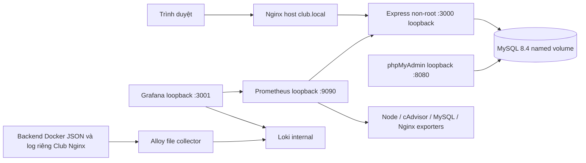

# Kiến trúc

Backend giữ cấu trúc routes/services/middleware/utils. Resource metadata là allowlist cứng cho table/column/type; không nhận tên SQL từ client. Transaction ghi dữ liệu và khóa parent bảo toàn liên kết. Không thêm migration khi schema 001–007 đã đủ nghiệp vụ yêu cầu. Phân quyền manager toàn hệ thống được người dùng duyệt; chưa có assignment theo CLB.

Thời gian lưu UTC: MySQL container mặc định UTC, driver UTC/dateStrings. Giao diện đổi datetime-local của trình duyệt sang UTC khi ghi và hiển thị theo timezone thiết bị. DATE thuần giữ YYYY-MM-DD. Xác minh timezone MySQL Ubuntu trước triển khai.

HTTP health cũ chỉ là liveness. `/api/ready` kiểm tra DB. Metrics không chứa ID tùy biến hoặc query string. JSON logs dùng allowlist fields, không ghi request body/headers. Nginx chặn `/metrics` công khai.

Host Nginx được dùng để không thay đổi mô hình hiện có hoặc tác động demo.local. Các exporter host chỉ được chạy sau kiểm tra quyền và tài nguyên trên Ubuntu. Cấu hình trong repo không phải minh chứng dịch vụ live.
