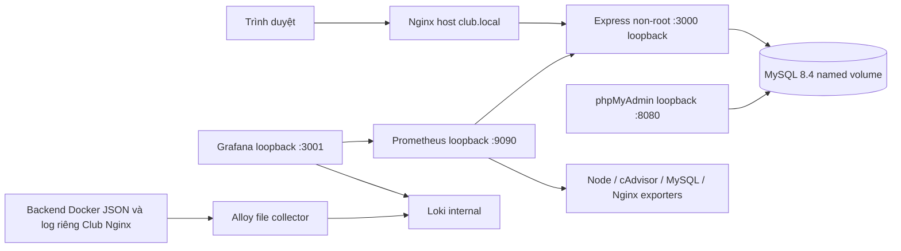

# Bản thảo báo cáo đồ án Club Management

Ngày 2026-10-19. Bản thảo có bằng chứng Windows; không phải biên bản nghiệm thu Ubuntu.

## 1. Giới thiệu đề tài và phạm vi

# Giới thiệu đề tài

Club Management hỗ trợ quản lý câu lạc bộ trong môi trường học tập với dữ liệu câu lạc bộ, thành viên, hoạt động, lịch họp và đóng góp. Mục tiêu là kết hợp chức năng web với kiến thức triển khai dịch vụ Linux, bảo mật và quan sát hệ thống. Một giao diện chạy được chưa đủ chứng minh chất lượng vận hành; đồ án cần mô tả dữ liệu, quyền, quy trình phục hồi và kết quả kiểm thử có nguồn gốc rõ ràng.

Ứng dụng được phát triển tiếp từ repository hiện có, không tạo dự án thay thế. Baseline main tại commit 293cf25 cung cấp Express, MySQL, frontend thuần và authentication giai đoạn hai. Các migration 001–007 được bảo toàn vì Ubuntu đã có dữ liệu. Mọi kiểm thử ghi dữ liệu trong quá trình hoàn thiện chỉ thực hiện trên MySQL dùng một lần ở Windows Docker Desktop.

Phạm vi gồm tài khoản do Admin tạo, ba vai trò Admin/Manager/Viewer, CRUD và quy trình ngừng hoạt động hoặc hủy giữ lịch sử. Không có đăng ký công khai, thanh toán trực tuyến, đăng ký/điểm danh hoạt động hoặc phân công manager theo từng CLB. Những chức năng ngoài phạm vi này cần yêu cầu nghiệp vụ và migration bổ sung được review.

Ma trận quyền nghiệp vụ đã được người dùng phê duyệt trong hội thoại: Viewer đọc dữ liệu nghiệp vụ kể cả thành viên/đóng góp, Manager đọc và ghi toàn bộ CLB, Admin quản lý thêm tài khoản. Dữ liệu CLB công khai cũ giữ nguyên hợp đồng API. Quyết định mở dữ liệu nội bộ cho người đã đăng nhập phải được nhắc lại trong hướng dẫn vận hành để người quản trị tạo tài khoản đúng đối tượng.

Bản thảo sử dụng bằng chứng từ source, kết quả Node tests, MySQL 8.4 cách ly, Chromium headless và validators của cấu hình Docker/monitoring. Các ảnh cuối báo cáo là ảnh thực từ môi trường test Windows. Mọi nội dung chưa kiểm chứng trên Ubuntu mang nhãn PENDING_UBUNTU_EVIDENCE; báo cáo không suy diễn rằng cấu hình tồn tại đồng nghĩa dịch vụ production hoạt động.


## 2. Phân tích hiện trạng và yêu cầu

# Kiểm toán baseline trước khi mở rộng

Bản ghi lịch sử ngày 2026-10-18, không mô tả HEAD hiện tại. Baseline: main, HEAD 293cf25c4dc741fdb2d42624fa5f9de53fae17e2.

Working tree ban đầu chỉ có `backend/tests/api/phase2-integration.test.js` untracked. Giữ đủ 26 test và assertion; fixture transaction được cập nhật cho truy vấn khóa mới, không ghi đè hoặc loại các ca kiểm thử có sẵn. Không thay đổi Git, migration 001–007 hoặc dữ liệu Ubuntu.

## Hiện trạng đã đọc từ source

Express phục vụ HTML/CSS/JS và ba router clubs/auth/users. Có session lưu hash token trong MySQL, scrypt, CSRF HMAC, kiểm tra Origin/Referer, rate limiter và RBAC admin cho user management. GET /api/clubs công khai trả nguyên danh sách không phân trang; giữ hợp đồng này. Có ba trang index/login/users. Có bảy migration InnoDB, FK, unique và CHECK. Node mục tiêu 22; Express 5.3.0 và mysql2 3.24.6 trong lockfile.

## GAP và kế hoạch

| Nhóm | Baseline | Bổ sung |
|---|---|---|
| Nghiệp vụ | CLB chỉ list; các bảng khác chưa có API/UI | CRUD, archive/cancel, lọc, phân trang, dashboard dữ liệu thật |
| Auth | Có chức năng nền | Cookie lỗi, validation, transaction mật khẩu, concurrency, logout UI |
| Database | 001–007 và runner | Schema verification, Docker assets, kiểm thử DB cách ly, backup/restore |
| Docker/Nginx | HTTP, backend non-root | Readiness, resources, TLS tùy chọn, migration job |
| Monitoring | Chưa có | Prometheus/exporters/Grafana provisioning/dashboard |
| Logging | stdout/stderr rời rạc | JSON an toàn, Loki/collector, retention/LogQL |
| Tests | 109 khai báo, 26 untracked | Baseline thực, negative/security/DB/browser checks |
| Tài liệu | Windows setup | README/API/schema/runbook/security/báo cáo |

## Lỗi và rủi ro baseline

- Cookie decoding có thể throw ngoài try và Promise authenticate chưa được return.
- Password update và session revocation không atomic; target user đọc trước transaction.
- Update email rỗng/type sai và duplicate race chưa được xử lý đầy đủ.
- Dockerfile không copy database; .dockerignore loại database.
- Dev init tạo bảng nhưng không ghi ledger; runner verify chỉ kiểm tra tên cột.
- Test migration có field lock_acquired khác lockAcquired, tạo false positive.
- Test setup giữ biến môi trường DB từ host; cần khóa kết nối mock và tách MySQL integration.
- HTTP nội bộ không mã hóa; COOKIE_SECURE=false chỉ phù hợp môi trường lab được giới hạn.
- Thiếu metrics, centralized logs, backup và README.

## Bảo toàn tương thích

Giữ URL và schema response cũ. Không sửa SQL 001–007. Không tự nâng quyền manager. Không thêm public registration. Không hardcode hoặc đọc secret thật. Các thao tác delete nghiệp vụ ưu tiên archive/inactive/cancelled; không xóa lịch sử đóng góp. Không xóa container/volume cũ.

## Chỉ có thể nghiệm thu trên Ubuntu

PENDING_UBUNTU_EVIDENCE: schema/ledger production, Docker resources, server blocks demo.local/club.local, firewall, DNS, HTTPS, exporter host/cgroup, quyền đọc log, dashboards/alerts, backup và restore trên bản sao. File cấu hình không chứng minh dịch vụ đã chạy.

Kết quả baseline và các lượt kiểm tra được ghi riêng trong TEST_RESULTS.md khi hoàn tất; 109 khai báo không mặc định là 109 PASS.

## Cập nhật bàn giao 2026-10-19

Nhánh hiện tại feature/club-management-completion; commit auth 117deee đã có trước lần tiếp quản cuối. Sáu nhóm chức năng đã được phân loại; kết quả kiểm chứng hiện tại và trạng thái cuối nằm trong TEST_RESULTS.md, FINAL_REPORT.md và báo cáo Git trực tiếp. Ma trận RBAC đã được người dùng phê duyệt. Không coi kết quả lịch sử 109/190 test là kết quả hiện tại.


## 3. Kiến trúc và công nghệ sử dụng

# Kiến trúc



Backend giữ cấu trúc routes/services/middleware/utils. Resource metadata là allowlist cứng cho table/column/type; không nhận tên SQL từ client. Transaction ghi dữ liệu và khóa parent bảo toàn liên kết. Không thêm migration khi schema 001–007 đã đủ nghiệp vụ yêu cầu. Phân quyền manager toàn hệ thống được người dùng duyệt; chưa có assignment theo CLB.

Thời gian lưu UTC: MySQL container mặc định UTC, driver UTC/dateStrings. Giao diện đổi datetime-local của trình duyệt sang UTC khi ghi và hiển thị theo timezone thiết bị. DATE thuần giữ YYYY-MM-DD. Xác minh timezone MySQL Ubuntu trước triển khai.

HTTP health cũ chỉ là liveness. `/api/ready` kiểm tra DB. Metrics không chứa ID tùy biến hoặc query string. JSON logs dùng allowlist fields, không ghi request body/headers. Nginx chặn `/metrics` công khai.

Host Nginx được dùng để không thay đổi mô hình hiện có hoặc tác động demo.local. Các exporter host chỉ được chạy sau kiểm tra quyền và tài nguyên trên Ubuntu. Cấu hình trong repo không phải minh chứng dịch vụ live.


## 4. Thiết kế dữ liệu và migration

# Database và migration

MySQL 8.4, InnoDB, utf8mb4_unicode_ci. Không sửa migration 001–007 đã áp dụng. Không cần migration mới vì các bảng hiện có đáp ứng CRUD đã được phê duyệt. Không có seed production.

## clubs (001_create_clubs.sql)

| Cột | Kiểu | Nullable | Default |
|---|---|---|---|
| id | bigint unsigned | False | None |
| name | varchar(150) | False | None |
| description | text | True | None |
| founded_date | date | True | None |
| status | enum('active','inactive') | False | active |
| created_at | timestamp | False | current_timestamp |
| updated_at | timestamp | False | current_timestamp |

Index: {"PRIMARY": {"columns": ["id"], "unique": true}}

Foreign keys: []

CHECK: {}

## members (002_create_members.sql)

| Cột | Kiểu | Nullable | Default |
|---|---|---|---|
| id | bigint unsigned | False | None |
| club_id | bigint unsigned | False | None |
| full_name | varchar(150) | False | None |
| email | varchar(191) | False | None |
| phone | varchar(20) | True | None |
| student_code | varchar(50) | True | None |
| joined_date | date | True | None |
| role | enum('member','leader','vice_leader') | False | member |
| status | enum('active','inactive') | False | active |
| created_at | timestamp | False | current_timestamp |
| updated_at | timestamp | False | current_timestamp |

Index: {"PRIMARY": {"columns": ["id"], "unique": true}, "uq_members_club_email": {"columns": ["club_id", "email"], "unique": true}, "idx_members_club_status": {"columns": ["club_id", "status"], "unique": false}}

Foreign keys: [{"name": "fk_members_club", "column": "club_id", "table": "clubs", "target": "id", "update": "CASCADE", "delete": "RESTRICT"}]

CHECK: {}

## activities (003_create_activities.sql)

| Cột | Kiểu | Nullable | Default |
|---|---|---|---|
| id | bigint unsigned | False | None |
| club_id | bigint unsigned | False | None |
| title | varchar(200) | False | None |
| description | text | True | None |
| location | varchar(255) | True | None |
| start_time | datetime | False | None |
| end_time | datetime | False | None |
| max_participants | int unsigned | True | None |
| status | enum('planned','ongoing','completed','cancelled') | False | planned |
| created_at | timestamp | False | current_timestamp |
| updated_at | timestamp | False | current_timestamp |

Index: {"PRIMARY": {"columns": ["id"], "unique": true}, "idx_activities_club_start": {"columns": ["club_id", "start_time"], "unique": false}, "idx_activities_status": {"columns": ["status"], "unique": false}}

Foreign keys: [{"name": "fk_activities_club", "column": "club_id", "table": "clubs", "target": "id", "update": "CASCADE", "delete": "RESTRICT"}]

CHECK: {"chk_activities_time": "end_time > start_time"}

## contributions (004_create_contributions.sql)

| Cột | Kiểu | Nullable | Default |
|---|---|---|---|
| id | bigint unsigned | False | None |
| member_id | bigint unsigned | False | None |
| amount | decimal(12,2) | False | None |
| contribution_date | date | False | None |
| payment_method | enum('cash','bank_transfer','other') | False | cash |
| status | enum('pending','confirmed','cancelled') | False | pending |
| description | text | True | None |
| created_at | timestamp | False | current_timestamp |
| updated_at | timestamp | False | current_timestamp |

Index: {"PRIMARY": {"columns": ["id"], "unique": true}, "idx_contributions_member_date": {"columns": ["member_id", "contribution_date"], "unique": false}, "idx_contributions_status": {"columns": ["status"], "unique": false}}

Foreign keys: [{"name": "fk_contributions_member", "column": "member_id", "table": "members", "target": "id", "update": "CASCADE", "delete": "RESTRICT"}]

CHECK: {"chk_contributions_amount": "amount > 0"}

## meetings (005_create_meetings.sql)

| Cột | Kiểu | Nullable | Default |
|---|---|---|---|
| id | bigint unsigned | False | None |
| club_id | bigint unsigned | False | None |
| title | varchar(200) | False | None |
| agenda | text | True | None |
| location | varchar(255) | True | None |
| start_time | datetime | False | None |
| end_time | datetime | False | None |
| status | enum('scheduled','completed','cancelled') | False | scheduled |
| notes | text | True | None |
| created_at | timestamp | False | current_timestamp |
| updated_at | timestamp | False | current_timestamp |

Index: {"PRIMARY": {"columns": ["id"], "unique": true}, "idx_meetings_club_start": {"columns": ["club_id", "start_time"], "unique": false}, "idx_meetings_status": {"columns": ["status"], "unique": false}}

Foreign keys: [{"name": "fk_meetings_club", "column": "club_id", "table": "clubs", "target": "id", "update": "CASCADE", "delete": "RESTRICT"}]

CHECK: {"chk_meetings_time": "end_time > start_time"}

## users (006_create_users.sql)

| Cột | Kiểu | Nullable | Default |
|---|---|---|---|
| id | bigint unsigned | False | None |
| username | varchar(50) | False | None |
| email | varchar(191) | False | None |
| password_hash | varchar(255) | False | None |
| full_name | varchar(150) | False | None |
| role | enum('admin','manager','viewer') | False | viewer |
| status | enum('active','disabled') | False | active |
| last_login_at | datetime | True | None |
| password_changed_at | datetime | False | current_timestamp |
| created_at | timestamp | False | current_timestamp |
| updated_at | timestamp | False | current_timestamp |

Index: {"PRIMARY": {"columns": ["id"], "unique": true}, "uq_users_username": {"columns": ["username"], "unique": true}, "uq_users_email": {"columns": ["email"], "unique": true}, "idx_users_role": {"columns": ["role"], "unique": false}, "idx_users_status": {"columns": ["status"], "unique": false}}

Foreign keys: []

CHECK: {}

## user_sessions (007_create_user_sessions.sql)

| Cột | Kiểu | Nullable | Default |
|---|---|---|---|
| id | bigint unsigned | False | None |
| user_id | bigint unsigned | False | None |
| token_hash | char(64) | False | None |
| csrf_secret | char(64) | False | None |
| ip_address | varchar(45) | True | None |
| user_agent | varchar(255) | True | None |
| created_at | timestamp | False | current_timestamp |
| last_active_at | timestamp | False | current_timestamp |
| expires_at | datetime | False | None |
| revoked_at | datetime | True | None |

Index: {"PRIMARY": {"columns": ["id"], "unique": true}, "uq_sessions_token_hash": {"columns": ["token_hash"], "unique": true}, "idx_sessions_user_active": {"columns": ["user_id", "revoked_at", "expires_at"], "unique": false}, "idx_sessions_expires": {"columns": ["expires_at"], "unique": false}}

Foreign keys: [{"name": "fk_sessions_user", "column": "user_id", "table": "users", "target": "id", "update": "CASCADE", "delete": "CASCADE"}]

CHECK: {}

## Quan hệ và dữ liệu

clubs 1-n members/activities/meetings; members 1-n contributions; users 1-n sessions. FK nghiệp vụ RESTRICT DELETE/CASCADE UPDATE; session CASCADE DELETE. API không xóa vật lý; inactive/cancelled giữ lịch sử. Username/email user unique toàn hệ thống; member email unique theo CLB. Amount DECIMAL trả chuỗi, không cộng tiền bằng float trong backend. ID BIGINT trong miền an toàn giữ kiểu number như API cũ; vượt Number.MAX_SAFE_INTEGER được driver trả chuỗi để tránh mất chính xác. Routes legacy CLB/user serialize ngày giờ thành ISO như trước, API nghiệp vụ mới dùng DATE/DATETIME UTC dạng chuỗi.

## Quy trình schema

- Database trống: `node --env-file=.env backend/scripts/migrate.js up --confirm` áp dụng SQL theo thứ tự dưới advisory lock. Chỉ chạy khi đã kiểm tra đúng target và backup.
- Database có 001–005: `verify`, rồi `baseline --confirm`, kiểm tra status, sau đó up cho phần thiếu.
- Database có đủ 001–007 do dev init hoặc triển khai cũ: `verify --all`, rồi `adopt --through=007 --confirm`. Adopt chỉ ghi ledger sau kiểm tra type/null/default/auto-update/PK/unique/index/FK/CHECK. Không sửa bảng hoặc dữ liệu.
- `status` chỉ đọc; `verify --all` chỉ đọc. `up` không có --confirm chỉ in status. Không tự migrate khi backend khởi động.
- Không tự adopt khi schema drift; dừng và điều tra. Schema khác manifest cần migration mới được review.

## Rủi ro và rollback

MySQL DDL có implicit commit; CREATE TABLE và ghi ledger không atomic. Nếu SQL thành công rồi ledger thất bại, runner dừng vì bảng tồn tại; không chạy lặp mù quáng. So sánh schema, snapshot và checksum, sau đó adopt có kiểm tra nếu đúng. Không sửa checksum cũ để che drift. Rollback ứng dụng bằng image cũ; schema chỉ thay đổi bổ sung tương thích. Khôi phục dữ liệu cần backup và thử trên DB cách ly trước; không có down migration phá hủy bảng.

## Transaction

Login xác minh scrypt ngoài transaction; sau đó khóa và đọc lại user, đối chiếu ID, trạng thái và password hash trước khi tạo session. Change/reset password khóa user và cập nhật hash/thu hồi session trong cùng transaction. Update role/status khóa active admins trước target, kiểm tra admin cuối, update và revoke cùng commit. Ghi nghiệp vụ khóa record và parent. Deadlock và lock timeout của MySQL trả 409; client thử lại thao tác sau khi kiểm tra trạng thái, không retry mù để tránh tạo bản ghi trùng.

PENDING_UBUNTU_EVIDENCE: đối chiếu full schema, timezone, collation và ledger thật; không giả định database Ubuntu trống.


## 5. Thiết kế API và phân quyền

# API

Response thành công: `{success:true,data:...}`; list mới thêm pagination `{page,limit,total,totalPages}`. Lỗi `{success:false,message}`. Health cũ giữ nguyên `{status,application,message}`.

Login nhận `{username,password}`; username có thể là email. Session cookie HttpOnly, không trả raw token trong body. `/api/auth/me` và `/csrf` trả CSRF token. Request ghi gửi `X-CSRF-Token` và Origin cùng APP_ORIGIN.

| Method | Endpoint | Quyền |
|---|---|---|
| GET | /api/health | Public |
| GET | /api/ready | Public, không tiết lộ DB error |
| GET | /api/clubs | Public, response legacy không pagination |
| POST | /api/auth/login | Public + Origin + limiter |
| POST | /api/auth/logout | Auth + CSRF |
| GET | /api/auth/me, /api/auth/csrf | Auth |
| PUT | /api/auth/password | Auth + CSRF + sensitive limiter |
| GET | /api/users, /api/users/:id | Admin |
| POST | /api/users | Admin + CSRF |
| PUT | /api/users/:id | Admin + CSRF |
| PATCH | /api/users/:id/status | Admin + CSRF |
| POST | /api/users/:id/reset-password | Admin + CSRF + sensitive limiter |
| GET | /api/dashboard, /api/catalog | Auth |
| GET | /metrics | Internal network; Nginx public block |

## /api/manage/clubs

| Method | Path suffix | Hành vi |
|---|---|---|
| GET | / | List, tìm kiếm, phân trang, role đã đăng nhập |
| GET | /:id | Chi tiết, role đã đăng nhập |
| POST | / | Tạo, Manager/Admin + CSRF |
| PUT | /:id | Sửa một phần hoặc đầy đủ field cho phép, Manager/Admin + CSRF |
| PATCH | /:id/status | Cập nhật status, Manager/Admin + CSRF |
| DELETE | /:id | Chuyển inactive/cancelled, giữ lịch sử, Manager/Admin + CSRF |

## /api/members

| Method | Path suffix | Hành vi |
|---|---|---|
| GET | / | List, tìm kiếm, phân trang, role đã đăng nhập |
| GET | /:id | Chi tiết, role đã đăng nhập |
| POST | / | Tạo, Manager/Admin + CSRF |
| PUT | /:id | Sửa một phần hoặc đầy đủ field cho phép, Manager/Admin + CSRF |
| PATCH | /:id/status | Cập nhật status, Manager/Admin + CSRF |
| DELETE | /:id | Chuyển inactive/cancelled, giữ lịch sử, Manager/Admin + CSRF |

## /api/activities

| Method | Path suffix | Hành vi |
|---|---|---|
| GET | / | List, tìm kiếm, phân trang, role đã đăng nhập |
| GET | /:id | Chi tiết, role đã đăng nhập |
| POST | / | Tạo, Manager/Admin + CSRF |
| PUT | /:id | Sửa một phần hoặc đầy đủ field cho phép, Manager/Admin + CSRF |
| PATCH | /:id/status | Cập nhật status, Manager/Admin + CSRF |
| DELETE | /:id | Chuyển inactive/cancelled, giữ lịch sử, Manager/Admin + CSRF |

## /api/meetings

| Method | Path suffix | Hành vi |
|---|---|---|
| GET | / | List, tìm kiếm, phân trang, role đã đăng nhập |
| GET | /:id | Chi tiết, role đã đăng nhập |
| POST | / | Tạo, Manager/Admin + CSRF |
| PUT | /:id | Sửa một phần hoặc đầy đủ field cho phép, Manager/Admin + CSRF |
| PATCH | /:id/status | Cập nhật status, Manager/Admin + CSRF |
| DELETE | /:id | Chuyển inactive/cancelled, giữ lịch sử, Manager/Admin + CSRF |

## /api/contributions

| Method | Path suffix | Hành vi |
|---|---|---|
| GET | / | List, tìm kiếm, phân trang, role đã đăng nhập |
| GET | /:id | Chi tiết, role đã đăng nhập |
| POST | / | Tạo, Manager/Admin + CSRF |
| PUT | /:id | Sửa một phần hoặc đầy đủ field cho phép, Manager/Admin + CSRF |
| PATCH | /:id/status | Cập nhật status, Manager/Admin + CSRF |
| DELETE | /:id | Chuyển inactive/cancelled, giữ lịch sử, Manager/Admin + CSRF |

`GET /api/clubs/:id`, POST/PUT/PATCH/DELETE `/api/clubs` cũng hỗ trợ thao tác tương ứng; chỉ GET list giữ legacy. `/api/contributions/summary` trả array `{status,count,total}` theo bộ lọc; tổng tiền là chuỗi DECIMAL.

## Query

`page` mặc định 1, `limit` 20, tối đa 100. `q` tối đa 200 ký tự; status/role theo enum; `club_id` cho member/activity/meeting và contributions qua member; `member_id` cho contributions. Search literal escape % và _. Query sai trả 400; không có pagination trong GET /api/clubs cũ.

## Payload

Danh sách field và enum từ `/api/catalog` hoặc DATABASE.md. Tạo yêu cầu các field NOT NULL nghiệp vụ trừ giá trị có default. PUT không nhận id/timestamps/field lạ. DATE YYYY-MM-DD; DATETIME UTC YYYY-MM-DD HH:mm:ss. Amount chuỗi decimal dương tối đa 9999999999.99. Không tạo/sửa dữ liệu dưới parent inactive; vẫn cho hủy/ngừng bản ghi để bảo toàn lịch sử.

## Mã lỗi

400 validation; 401 chưa đăng nhập/hết phiên; 403 sai role/CSRF/origin; 404 không tìm thấy; 409 duplicate/FK/admin cuối/parent inactive; 429 limiter; 500 lỗi nội bộ; 503 readiness DB. Error 500 production không trả SQL/error.message. Không có public registration.


## 6. Giao diện và hướng dẫn sử dụng

# Hướng dẫn sử dụng

## Vai trò

Admin quản lý tài khoản, role, khóa và reset mật khẩu. Manager quản lý nghiệp vụ của tất cả CLB. Viewer chỉ đọc, bao gồm dữ liệu thành viên và đóng góp theo ma trận đã duyệt. Khách chỉ xem home và API CLB công khai cũ.

## Luồng làm việc

1. Admin tạo tài khoản trong trang Tài khoản. Không có đăng ký công khai.
2. Đăng nhập; mở Tổng quan để xem số CLB/thành viên/hoạt động, tổng đóng góp confirmed và 10 lịch họp tương lai gần nhất.
3. Tạo CLB trước, ghi lại ID. Tạo thành viên bằng CLB ID; email duy nhất trong cùng CLB.
4. Tạo hoạt động/họp với CLB ID, thời gian kết thúc phải sau bắt đầu. Thời gian nhập theo timezone trình duyệt.
5. Tạo đóng góp bằng member ID, số tiền dương với tối đa hai số lẻ. Chỉ confirmed được tính vào tổng dashboard; các trạng thái khác được thống kê riêng.
6. Dùng Chi tiết để xem toàn bộ trường; Sửa để cập nhật. Ngừng/Hủy có xác nhận và chỉ đổi trạng thái, không xóa vật lý.
7. Tìm kiếm và lọc trạng thái/CLB ID; phân trang 20 dòng. Trang đóng góp hiển thị tổng theo trạng thái dựa trên bộ lọc hiện tại.
8. Hồ sơ cho phép đổi mật khẩu bản thân, giữ phiên hiện tại và thu hồi các phiên khác. Admin reset password thu hồi mọi phiên của tài khoản đích.
9. Đăng xuất chỉ chuyển trang khi server xác nhận thành công. Nếu mất mạng, thử lại.

Không nhập thông tin cá nhân vào trường tên CLB nếu danh sách đó cần công khai. Các trang nghiệp vụ mới yêu cầu đăng nhập. Không đưa tài khoản thật lên báo cáo hoặc screenshot công khai. Giao diện ID cho liên kết dùng ID có thật; server kiểm tra FK, không tự tạo CLB/thành viên thay thế.


## 7. Docker, Nginx và HTTPS

# Runbook Ubuntu

Trạng thái: PENDING_UBUNTU_EVIDENCE. Không có lệnh nào trong tài liệu được tự chạy trên Ubuntu. Mọi thao tác production cần backup, review target và quyền vận hành của người dùng. Giữ nguyên project name/volume/network đang dùng; không dùng `down -v`, prune hoặc reset.

## 1. Kiểm kê chỉ đọc

Ghi lại OS, Docker version, dung lượng/RAM, network, container names, image IDs, volumes, cổng 80/443/3000/8080/3307/3001/9090/8081, Nginx server blocks và demo.local. `scripts/ubuntu-precheck.sh` có mục thử kết nối MySQL; không chạy nguyên script khi chưa được phép đọc DB. Không dùng `docker inspect` không lọc vì có thể in env secret.

## 2. Cấu hình

`.env` ngoài Git, chmod 600, dùng giá trị hiện tại được quản trị viên cung cấp trực tiếp trên host. Đặt APP_ORIGIN chính xác URL browser (scheme/host/port), SESSION_TTL_HOURS=8. HTTP lab dùng COOKIE_SECURE=false. Backend Compose dùng DB_HOST=mysql:3306 nội bộ; không publish MySQL. Không đổi MYSQL_PASSWORD của volume cũ bằng cách chỉ sửa env: password database không tự thay đổi.

Chỉ chạy `docker compose config --quiet`; không đưa bản config expanded chứa secret vào báo cáo. Xác nhận Node timezone/DB UTC.

## 3. Schema và backup

Tạo backup, kiểm tra checksum và restore trên bản sao trước. Xem DATABASE.md. Nếu Ubuntu có đủ 001–007, chạy verify --all rồi adopt --through=007 --confirm sau review. Nếu ledger đã đúng, up chỉ áp dụng phần chưa có. Không bật compose.dev.yaml trên production.

```bash
docker compose -f compose.yaml -f compose.backend.yaml -f compose.migrate.yaml build backend migrate
docker compose -f compose.yaml -f compose.backend.yaml -f compose.migrate.yaml run --rm migrate node backend/scripts/migrate.js status
docker compose -f compose.yaml -f compose.backend.yaml -f compose.migrate.yaml run --rm migrate node backend/scripts/migrate.js verify --all
```

Các lệnh baseline/adopt/up phải do người vận hành chọn theo schema thật, không tự động copy toàn bộ runbook. Backend không auto-migrate.

## 4. Backend

Sau khi schema/ledger xác nhận, `docker compose -f compose.yaml -f compose.backend.yaml up -d backend`. Giữ nguyên project hiện tại để gắn đúng mysql_data. Kiểm tra container healthy và curl 127.0.0.1:3000/api/health, /api/ready. Tạo Admin chỉ nếu chưa có; không ghi đè Admin Ubuntu. Không đưa password qua CLI.

## 5. Nginx HTTP

Backup riêng cấu hình Club hiện tại. Cài `nginx/club-logging.conf` vào http-context include (ví dụ /etc/nginx/conf.d/00-club-logging.conf). Cài duy nhất `club-management.conf` vào sites-available/sites-enabled cho club.local; không thay nginx.conf tổng hoặc demo.local. `nginx -t` thành công trước reload. File log riêng Club. XFF được overwrite, không tin header client. Kiểm tra DNS/hosts từ máy truy cập.

`club-status.conf` là tùy chọn exporter: bind 172.17.0.1:8081 phải thay bằng địa chỉ docker0 thực tế nếu khác. Chỉ allow exporter subnet thực cần thiết. Không mở status ra Internet; kiểm tra firewall và bind trước enable. Kiểm tra Windows đã thay IP bind bằng loopback trong bản test, không chứng minh IP Ubuntu hợp lệ.

## 6. HTTPS self-signed tùy chọn

Chỉ thay server block club.local sau khi người dùng đồng ý chuyển URL. Tạo certificate/key trên Ubuntu, không copy vào repo:

```bash
sudo install -d -m 700 /etc/nginx/club-tls
sudo openssl req -x509 -nodes -newkey rsa:3072 -days 365 -keyout /etc/nginx/club-tls/club.local.key -out /etc/nginx/club-tls/club.local.crt -subj /CN=club.local -addext subjectAltName=DNS:club.local
sudo chmod 600 /etc/nginx/club-tls/club.local.key
```

Dùng `club-management.https.conf.example`, APP_ORIGIN=https://club.local, COOKIE_SECURE=true. Kiểm tra Nginx -t, rồi reload duy nhất Nginx và recreate backend có kiểm soát. Người dùng tự tin cậy certificate test; không tự bypass browser warning. Không bật HSTS trước khi bảo đảm TLS trust và rollback HTTP phù hợp. Re-login sau chuyển scheme.

## 7. Monitoring/logging và rollback

Xem OBSERVABILITY.md; triển khai sau backend ổn định, không mặc định bật host collectors trên máy thiếu RAM. Rollback ứng dụng bằng image tag/compose snapshot trước nâng cấp; không rollback dữ liệu bằng xóa volume. Nếu migration lỗi dừng, giữ snapshot và điều tra. PENDING_UBUNTU_EVIDENCE: startup/reboot, dữ liệu cũ, demo.local regression, firewall, TLS/cookie, exporter UP, log permissions và backup drill.

## Trình tự bàn giao cuối

Xem UBUNTU_HANDOVER.md để kiểm kê project/volume/port, giữ MySQL hiện tại, chạy migrate job với --no-deps và chỉ recreate backend sau backup/schema review. Không dùng lệnh up toàn bộ khi chưa kiểm tra các dịch vụ có sẵn.


## 8. Monitoring và logging tập trung

# Monitoring và logging

## Phiên bản và phạm vi

Compose bổ sung không tự chạy. Prometheus 7 ngày/512MB; Loki 72 giờ, ingest 2MB/s, query parallelism 2; mỗi service có giới hạn RAM/CPU. Tổng RAM cần tính thêm MySQL/backend/host. Không có endpoint quản trị bind public: Grafana 127.0.0.1:3001, Prometheus 127.0.0.1:9090; exporters/Loki chỉ bridge network. Dùng SSH tunnel nếu cần truy cập từ Windows. Không bật anonymous Grafana.

Promtail đã EOL 2026-03-02: [Grafana chính thức](https://grafana.com/docs/loki/latest/send-data/promtail/). Cấu hình được cung cấp để đối chiếu đồ án trong profile `legacy-promtail`; Alloy là collector mặc định còn được hỗ trợ. Không chạy hai collector cùng lúc trên cùng file. Quy trình migration: [Grafana Alloy](https://grafana.com/docs/alloy/latest/set-up/migrate/from-promtail/).

## Secret prerequisites

Tạo thư mục secrets ngoài Git, chmod 700; file password Grafana và mysql-exporter.cnf chmod 600. Compose secrets dùng file, không tự mã hóa file trên host. Không gửi nội dung vào chat.

Exporter dùng tài khoản riêng, SELECT/PROCESS/REPLICATION CLIENT và MAX_USER_CONNECTIONS nhỏ theo [mysqld_exporter](https://github.com/prometheus/mysqld_exporter). Host/phạm vi account phải phù hợp bridge thực tế. File cấu hình có phần [client], user, password, host=mysql, port=3306. Không dùng root hoặc app account. Khai báo GRAFANA_ADMIN_PASSWORD_FILE và MYSQL_EXPORTER_CONFIG_FILE nếu đường dẫn khác mặc định. Không lưu secret vào datasource/dashboard.

## Triển khai sau phê duyệt trên Ubuntu

```bash
docker compose -f compose.yaml -f compose.backend.yaml -f compose.monitoring.yaml -f compose.logging.yaml config --quiet
docker compose -f compose.yaml -f compose.backend.yaml -f compose.monitoring.yaml -f compose.logging.yaml up -d
```

Lệnh trên là triển khai, chưa được chạy bởi Codex. Giữ nguyên project production. Theo dõi memory/disk sau khi bật; Grafana provisioning UID cố định club-prometheus/club-loki, dashboard Club Management Operations.

Node Exporter mount root host read-only và pid host; cAdvisor cần /sys,/var/lib/docker,/dev/kmsg. Đây là quyền host rộng, không phải container ứng dụng least-privilege. Không bật privileged tự động nếu exporter thất bại; kiểm tra cgroup/permission và giảm collector phù hợp. Nginx exporter dùng host.docker.internal:8081; cấu hình status bind đúng docker0 và allow subnet cụ thể. Docker Desktop metrics không thay thế số liệu Ubuntu VMware.

## Chỉ thu thập Club logs

Đặt CLUB_BACKEND_LOG_DIR là thư mục chứa LogPath của đúng backend Club container. Dùng `docker inspect --format '{{.LogPath}}' <exact-backend-container>` để lấy path; không dump env. Đặt CLUB_NGINX_LOG_DIR=/var/log/nginx; collector chỉ match tên club-management.access.log/error.log. Không mount Docker socket. Sau recreate backend cần cập nhật LogPath/thư mục và collector; file path cũ không tự theo container mới.

Backend stdout JSON có level/event/method/route chuẩn hóa/status/duration/request ID, không có body, query string, password/cookie/Authorization. Nginx access format chỉ thời gian, method, status, bytes, duration. Nginx error raw có thể chứa request URI; collector thay bằng thông điệp tổng quát nginx_error để không gửi nội dung nhạy cảm. Raw error chỉ nằm host dưới quyền quản trị. Tránh dùng đường dẫn chứa secret trong client request.

## Kiểm chứng

1. Prometheus /targets: prometheus, club-backend, node, containers, mysql, nginx đều UP. Ngoài up, mysql_up/nginx_up phải bằng 1.
2. Grafana datasource Save & Test; dashboard hiển thị request rate/p95/RSS, host CPU/RAM, container CPU/RAM, MySQL connections và Nginx request rate.
3. Gây 404 bằng URL không tồn tại và quan sát metric/log. Chỉ thử 5xx trên môi trường test, không ngắt DB production.
4. Loki /ready từ internal network; Grafana Explore tìm các log dưới đây. Export request query/secret không được xuất hiện.
5. Kiểm tra retention bằng config và dung lượng theo thời gian; retention thời gian không đảm bảo giới hạn tuyệt đối disk. Backup/đặt alert disk trước khi đầy.

## LogQL

```logql
{service="backend"} | json | level="error"
{service="backend"} | json | event="http_request" | status >= 400
sum by (service) (count_over_time({service=~"backend|nginx"} | json | status >= 500 [5m]))
{service="nginx",stream="error"} |= "nginx_error"
```

Ba truy vấn đầu lần lượt tìm lỗi, HTTP 4xx/5xx và đếm 5xx theo service. Request ID dùng tìm log nhưng không làm Prometheus label. Chưa có Alertmanager receiver: rules đánh giá trong Prometheus, không tuyên bố có email/Slack notification. PENDING_UBUNTU_EVIDENCE cho target UP, quyền đọc file, host metrics, retention thực và dashboard screenshots.

## Legacy profile

Nếu buộc dùng Promtail cho lab: người vận hành phải dừng service alloy của đúng project trước, rồi chỉ up service promtail/loki bằng --profile legacy-promtail. Không chạy lệnh up toàn bộ profile khi Alloy đang chạy vì sẽ gửi log trùng. Đây là thao tác triển khai cần người vận hành quyết định, chưa được Codex thực hiện.

## Runtime cách ly đã kiểm chứng trên Windows

`npm run test:observability`: Grafana health, provisioning hai datasource UID và dashboard 12 panel. `npm run test:logging`: tạo application log bằng logger thật, bao Docker JSON log, cho Alloy đọc file và gửi vào Loki tạm. Ba truy vấn xác nhận lỗi backend, HTTP 404/500 và Nginx error đã được thay nội dung nhạy cảm; fixture bí mật không xuất hiện trong kết quả. Container/network riêng, tmpfs và cổng localhost ngẫu nhiên; không mount Docker socket hoặc log production. Các kết quả này không chứng minh exporter hoặc collector Ubuntu đã hoạt động.


## 9. Security hardening

# Security checklist

## Đã triển khai trong mã nguồn

- [x] Scrypt salt ngẫu nhiên, timing-safe compare, giới hạn input password.
- [x] Session token ngẫu nhiên, DB chỉ lưu hash, expiry/revocation và account status.
- [x] Cookie HttpOnly/SameSite; Secure theo môi trường, không đọc bằng JS.
- [x] CSRF HMAC và Origin/Referer cho ghi; login origin validation.
- [x] RBAC backend; Manager/Viewer theo phê duyệt trong RBAC_PROPOSAL.md.
- [x] Validation allowlist fields, ID, enum, date/time, currency, email.
- [x] Query bound parameters; table/column identifiers từ metadata cứng.
- [x] Render textContent; CSP, nosniff, frame/referrer headers.
- [x] Login rate limit IP/account và giới hạn request đang xử lý.
- [x] Đổi/reset mật khẩu dùng transaction và user lock; thu hồi session.
- [x] Bảo vệ admin active cuối cùng và self-disable.
- [x] Cookie lỗi không gây unhandled rejection.
- [x] Backend non-root, read-only, cap_drop ALL, no-new-privileges, resources/log rotation.
- [x] Backend/phpMyAdmin chỉ publish loopback; MySQL production không publish cổng.
- [x] Logs không có body, cookie, password, Authorization hoặc query string.
- [x] Nginx ghi đè XFF bằng IP client quan sát được; chặn public metrics.
- [x] Secret files/env không đưa vào image/repository.

## Điều kiện triển khai cần kiểm tra

- [ ] PENDING_UBUNTU_EVIDENCE: HTTPS, APP_ORIGIN và Secure cookie thực tế. HTTP chỉ dành lab nội bộ giới hạn.
- [ ] Mật khẩu mạnh riêng từng dịch vụ, quyền file secret, rotate theo chính sách; không yêu cầu người dùng gửi secret cho Codex.
- [ ] Exporter user SELECT/PROCESS/REPLICATION CLIENT với giới hạn kết nối; không dùng root/app account.
- [ ] Xác minh network, firewall, exact trusted proxy chain và cổng không public.
- [ ] Xác minh image CVE/digest trước triển khai; npm audit không bao gồm OS/image vulnerabilities.
- [ ] Backup mã hóa, retention và restore drill.
- [ ] Xác minh collector chỉ đọc Club logs; Node/cAdvisor có quyền đọc host rộng, chỉ chạy sau review.
- [ ] Promtail EOL chỉ dùng khi chấp nhận rủi ro legacy; Alloy là mặc định.
- [ ] Không có password public registration/MFA; MFA chưa nằm phạm vi nghiệp vụ hiện tại.

Rate limiter theo process không dùng shared store; mô hình hiện tại một backend. Nếu scale nhiều replica cần thiết kế limiter chung. Không log metric label theo user/request ID để tránh lộ dữ liệu và cardinality. Không tuyên bố hệ thống không có lỗ hổng chỉ dựa vào audit dependency.


## 10. Backup, restore và vận hành

# Backup và restore

Named volume không phải backup. Không xóa mysql_data và không chạy restore lên database đang phục vụ để thử nghiệm.

## Backup

Chạy `bash scripts/backup.sh` trên Ubuntu sau khi đặt MYSQL_CONTAINER đúng tên container Club MySQL và BACKUP_DIR trên nơi lưu trữ đủ dung lượng. Script chỉ chấp nhận tên có club-management và mysql, dùng credential có sẵn trong container, không in hoặc truyền password qua argv. mysqldump single-transaction/no-tablespaces tạo file partial, đổi tên khi thành công và sinh SHA-256. Thư mục/file chỉ owner truy cập theo umask 077.

Không chạy DDL đồng thời với single-transaction dump. Xem xét quyền routines/events của app user; nếu thiếu dùng tài khoản backup riêng do quản trị viên cấp, không tăng quyền app chỉ để dump. Script không tự cấp quyền. Bản backup chứa thông tin cá nhân, password hash và session metadata; không commit/chia sẻ công khai. Mã hóa bằng công cụ quản trị đã phê duyệt và lưu bản sao ngoài VM. Không ghi khóa mã hóa vào repo.

## Restore drill

Tạo container riêng tên club-management-restore-<mã>, database rỗng, volume hoặc tmpfs riêng, bắt buộc có label `club-management.restore-test=true`. Đặt RESTORE_CONTAINER, BACKUP_FILE, CONFIRM_RESTORE=<đúng tên container> rồi `bash scripts/restore-test.sh`. Script kiểm tra checksum và chỉ cho phép target prefix restore. Không tự tạo/xóa volume, không chấp nhận tên production, target thiếu label hoặc database đã có bảng.

Sau restore: verify --all, đối chiếu row count/tổng đóng góp, FK/CHECK/index, đăng nhập bằng tài khoản test được quản trị viên cho phép, kiểm tra không dùng session production. Chỉ kết luận restore thành công khi nội dung được kiểm chứng, không chỉ vì mysql exit 0. Runbook phục hồi production phải có downtime, backup trước thay đổi, quyền truy cập và rollback riêng do quản trị viên duyệt.

## Bằng chứng cách ly trên Windows

`npm run test:backup` tạo hai MySQL 8.4 với tmpfs và cổng localhost ngẫu nhiên, áp dụng 001–007 trên nguồn, dump và restore sang target rỗng. Script đối chiếu full schema, 7 ledger entries và tên CLB fixture; kiểm tra từ chối confirmation sai, dump sai checksum và target không rỗng. Mật khẩu sinh trong bộ nhớ, không đọc `.env`. Chỉ dọn container do lượt chạy tạo và có nhãn disposable; dump test nằm trong artifacts bị Git ignore. Đây không phải minh chứng backup dữ liệu Ubuntu.

## Lịch và retention đề xuất

Backup hàng ngày, trước migration/nâng cấp; giữ 7 bản ngày và 4 bản tuần theo dung lượng thực; diễn tập restore định kỳ. Đây là đề xuất, chưa cài cron/timer hoặc xóa backup tự động. PENDING_UBUNTU_EVIDENCE: dump/restore thực, mã hóa, quyền file, lịch chạy và RPO/RTO đã duyệt.


## 11. Thiết kế kiểm thử

# Kiểm thử

## Mock suite

`npm test` dùng Node test runner. Preloader cưỡng chế DB mock trên loopback port 1 và thay query/execute/getConnection thật bằng guard. Transaction adapter chỉ chuyển tiếp mock query; nó KHÔNG chứng minh transaction MySQL. Mỗi file đóng pool; HTTP tests đóng server. Không truyền `.env` vào mock suite.

Baseline trước sửa: 109/109 PASS. File phase2-integration untracked ban đầu được giữ đủ 26 test; chỉ điều chỉnh fixture transaction cho truy vấn khóa mới, không loại hoặc làm yếu assertion. Test migration được viết lại để assertion chứng minh đã tới nhánh checksum/lock, đồng thời kiểm tra type/default/unique/FK/CHECK.

## MySQL thật và Chromium

`npm run test:db` chạy orchestrator tạo container MySQL 8.4 disposable, tmpfs và cổng ngẫu nhiên loopback; mật khẩu sinh trong bộ nhớ. Migration up, strict verify toàn bộ schema, up lần hai để kiểm tra idempotency. Sau đó API tests dùng database thật, Playwright Chromium headless chạy giao diện thực và chụp ảnh thật vào artifacts (gitignored). Cuối cùng chỉ xóa đúng container có nhãn disposable do lượt chạy tạo.

Suite MySQL sử dụng database thật. Các ca cạnh tranh dùng mock điều phối thời điểm gọi hàm password/query nhưng vẫn chạy scrypt, SQL và transaction thật; ca lỗi last_login_at chủ động inject lỗi để kiểm tra rollback. Đây không phải suite SQL hoàn toàn không có test double. Khẳng định guard database tên `club_management_test` và host 127.0.0.1 trước thao tác. Docker không hoạt động hoặc chưa cài Chromium là BLOCKED, không được đánh dấu PASS. Không dùng production volume. Nếu process bị kill cưỡng bức, kiểm tra thủ công container tên test và nhãn trước cleanup; không xóa wildcard.

## Cấu hình

`npm run test:syntax`; Compose `config --quiet` dùng env placeholder; image build bằng tag verification. `promtool check config`, Loki verify-config, Alloy validate và Nginx -t chạy trong container tạm. Windows không xác minh bind IP docker0 Ubuntu, host exporters, log permissions, TLS trust hoặc site demo.local.

`npm run test:config` tái lập 11 bước kiểm tra cấu hình/certificate tạm/bash; `npm run test:observability` chạy Grafana disposable tmpfs kiểm tra provisioning và dashboard thật. Không cần credential Ubuntu. Đặt CLUB_TEST_BACKEND_IMAGE=club-management:verification khi chạy test:db để kiểm tra thêm backend image đã build, non-root/read-only và healthcheck.

## Bằng chứng

Kết quả hiện tại ở TEST_RESULTS.md. Mỗi lần thay code cần chạy lại suite liên quan và regression. Screenshot được sinh bằng browser trên dữ liệu test, không phải minh chứng Ubuntu. Coverage percentage chưa đo; không suy ra từ test count.

## Backup, logging và kiểm tra Git

`npm run test:backup` thực thi backup/restore trên hai MySQL dùng một lần, kiểm tra schema/dữ liệu và ba điều kiện từ chối nguy hiểm. Windows cần Git Bash hoặc BASH_BIN; Linux dùng bash.

`npm run test:logging` chạy Loki và Alloy trên network riêng, dùng log tạo bởi logger thật cùng fixture Nginx; ba truy vấn LogQL phải có dữ liệu và không chứa marker bí mật. Không đọc log production.

`node scripts/check-secrets.js --history-base=293cf25` quét mẫu credential trong source/config/docs, nội dung và đường dẫn index, cùng các snapshot Git sau baseline. Binary PDF và .env thật không được đọc bởi scanner; PDF được kiểm tra nội dung riêng. Không coi pattern scanner là bằng chứng loại trừ mọi dạng secret.


## 12. Kết quả thực nghiệm và giới hạn

# Kết quả kiểm thử thực tế

Ngày kiểm chứng: 2026-10-19 (Asia/Saigon). Windows, Node 22.23.3 qua fnm, Docker Desktop Linux containers, MySQL 8.4. Phạm vi: nhánh feature/club-management-completion và các file tài liệu/CI chuẩn bị cho commit cuối. Đây là kết quả local, không phải bằng chứng Ubuntu hoặc GitHub Actions đã PASS.

| Lệnh hoặc nhóm | Kết quả đã chạy | Giới hạn |
|---|---|---|
| Baseline lần tiếp quản cuối | 282/282 PASS, FAIL 0 | Không dùng kết quả lịch sử 109/190 thay baseline này |
| npm test | 283/283 PASS, FAIL 0, SKIP 0 | Unit/API mock, có guard chặn DB thật |
| Snapshot staging commit API | 277/277 PASS | Xuất index ra thư mục tạm, không có file untracked |
| Snapshot staging commit deploy | 282/282 PASS | Kiểm tra cả readiness 200/503 và dependency import |
| npm run test:syntax | 61 file JS PASS | node --check, không phải chứng minh nghiệp vụ |
| npm run test:db | 19/19 PASS, FAIL 0, SKIP 0 | 17 ca SQL/API/transaction và 2 ca Chromium thật |
| Migration/schema | PASS | Up 001–007, verify --all, up lần hai không áp dụng lại |
| CLUB_TEST_BACKEND_IMAGE + test:db | PASS | Readiness healthy, non-root/read-only, đủ 7 SQL và không chứa tests |
| npm run test:backup | 4 nhóm kiểm tra PASS | Dump/restore thật, schema/ledger/data khớp; từ chối confirm sai, checksum sai, target không rỗng |
| npm run test:config | 11/11 bước PASS | Compose, Prometheus/rules, Loki, Alloy, Promtail legacy, Nginx HTTP/TLS, Bash |
| npm run test:observability | PASS | Grafana health, 2 datasource UID, dashboard 12 panel |
| npm run test:logging | 3/3 truy vấn runtime PASS | Alloy đọc fixture log và gửi Loki thật; backend error, HTTP 404/500, Nginx error được che nội dung |
| npm audit --audit-level=high | 0 vulnerabilities | Chỉ dependency npm, không bao gồm OS/image CVE |
| node scripts/check-secrets.js --history-base=293cf25 | 0 findings trong phạm vi quét | Source/config/docs, index và snapshot Git; không đọc .env thật; binary được review riêng |
| git diff --check | PASS | Cảnh báo LF/CRLF không phải lỗi whitespace |
| Docker image build | PASS | Tag club-management:verification, không triển khai Ubuntu |

## Nguồn bằng chứng và lệnh tái lập

Dùng Node 22. Trên Windows có thể chạy `fnm exec --using 22 npm.cmd test` và `fnm exec --using 22 node scripts/test-mysql.js`. Các lệnh npm khác trong bảng trỏ tới script cùng tên trong package.json. Để kiểm tra image: `docker build -t club-management:verification .`, đặt CLUB_TEST_BACKEND_IMAGE=club-management:verification rồi chạy test:db. Không nạp `.env` production.

TAP/log được giữ cục bộ trong thư mục TEMP (club-final-baseline.tap, club-image-mysql.tap, club-observability-regression.tap, club-final-config.log, club-final-backup.log) và các lượt trước push. Screenshot Chromium và kết quả config nằm trong artifacts bị Git ignore. CI tái lập lệnh trên runner biệt lập, không dùng credential Ubuntu. Không cộng số assertions, bước shell và số test TAP thành một con số coverage.

## Những tình huống đã kiểm chứng

CRUD và quan hệ năm nhóm nghiệp vụ; validation, phân trang, UNIQUE/FK/CHECK thật; bound SQL và literal wildcard; dashboard và tổng DECIMAL; soft deletion giữ row; Viewer đọc và bị chặn ghi, Manager/Admin ghi với CSRF/Origin hợp lệ. Helper mock xác nhận đúng cả ba role qua /api/auth/me, kiểm tra CSRF/Origin thiếu/sai và không thực hiện query ghi khi bị chặn.

Scrypt login chạy trước khi lấy connection transaction. Nếu disable/change/reset password thắng trước, locked recheck từ chối trạng thái/hash cũ; nếu login lấy khóa trước, mutation sau thu hồi session. Rollback lỗi không che lỗi gốc; release được gọi. Lỗi last_login_at làm session insert rollback. Admin demotion đồng thời không để hệ thống hết active Admin.

Chromium thật kiểm tra login, tạo CLB, dashboard mobile không tràn, profile/logout, Viewer không thấy chức năng ghi và Admin tạo user. Ảnh chỉ chứa fixture test trên MySQL tạm, không phải production.

## Lỗi phát hiện và sửa trong quá trình hoàn thiện

Các lần phát triển trước đã sửa fixture lock sai shape, Number cho GET_LOCK, test pool guard, khởi tạo state frontend, LF Bash và bind IP Nginx status chỉ dành Ubuntu. Lượt cuối bổ sung readiness thành công để bắt thiếu import pool trong snapshot staging; dependency được đưa đúng commit trước khi commit. Các test metrics/security được tách khỏi business để tránh phụ thuộc commit tương lai. Restore rehearsal bổ sung label/empty-target guard. Tài liệu RBAC và số test cũ được cập nhật, tiếng Việt được ghi UTF-8.

## Chưa được xác minh

PENDING_UBUNTU_EVIDENCE: schema/ledger và dữ liệu Ubuntu, TLS trust/cookie, demo.local, firewall/cổng, exporter host/cAdvisor/MySQL/Nginx UP, ingestion log host thật, retention dài hạn, backup dữ liệu thật và image/OS CVE review. Nginx status validation trên Windows thay IP docker0 bằng loopback trong bản tạm. Không có kiểm thử tải lớn hoặc coverage percentage. Những giới hạn này không được đánh dấu PASS.

GitHub Actions có kết quả riêng từ PR sau push; không mặc định workflow PASS dựa vào bảng local.


## 13. Kết luận và hướng phát triển

# Kết luận và hướng phát triển

Mã nguồn được mở rộng trong kiến trúc Node.js/Express/MySQL và frontend HTML/CSS/JavaScript sẵn có. Các API cũ được duy trì; danh sách CLB phân trang dùng endpoint quản trị riêng để không thay response legacy. Nghiệp vụ mới dùng metadata allowlist, validation, transaction, FK và phân quyền backend. Giao diện lấy dữ liệu thật và không chèn dữ liệu API bằng innerHTML.

Hoàn thiện vận hành bao gồm backend image non-root có migration assets, readiness, graceful shutdown, giới hạn tài nguyên và log rotation. Nginx có file log riêng, chặn public metrics và mẫu HTTPS tách riêng. Prometheus/Grafana và Loki/Alloy có cấu hình provisioning cùng dashboard/query; Promtail được giữ trong profile legacy do đã EOL. Không giả định có cảnh báo qua email/Slack khi chưa cấu hình receiver.

Kết quả kiểm thử chính thức nằm trong chương kết quả thực nghiệm. Mock suite kiểm tra logic và contract nhưng không thể thay thế MySQL transaction hoặc trải nghiệm trình duyệt. Vì vậy test database cách ly và browser được chạy riêng; lỗi phát hiện trong các lượt đầu được sửa và chạy lại. Kết quả PASS có phạm vi theo commit/workspace và môi trường, không phải cam kết hệ thống không còn lỗi.

Trước nghiệm thu cuối, cần xác minh Ubuntu VMware: schema và migration ledger có dữ liệu cũ, Nginx club.local không ảnh hưởng demo.local, firewall, timezone, HTTPS/cookie, exporter UP, quyền collector đọc đúng file, retention và restore drill. Không xóa volume để giải quyết lỗi quyền hoặc migration. Người vận hành cần có bản backup được thử phục hồi và kế hoạch quay lại image trước đó.

Các hướng phát triển có thể gồm assignment user–CLB, đăng ký/điểm danh hoạt động, xuất báo cáo, MFA, audit trail lưu bền, shared rate limiter và notification receiver. Mỗi mở rộng cần tiêu chí nghiệp vụ, đánh giá bảo mật, migration bổ sung tương thích và kiểm thử riêng. Không tự bổ sung những chức năng này vào production chỉ để tăng số lượng tính năng.

PENDING_UBUNTU_EVIDENCE: ảnh target UP, dashboard host thực, Grafana Explore, HTTPS/cookie và kết quả backup/restore. Chỉ kết luận sẵn sàng vận hành sau khi các điều kiện này được nghiệm thu bởi người quản trị môi trường cuối.

Workflow GitHub CI kiểm tra mock/security/syntax, database/browser, backup/restore, Docker/config, Grafana provisioning và Alloy/Loki trên runner biệt lập. Kết quả GitHub cần xem từ PR; không suy ra từ local PASS. Thay đổi được chia thành các commit chức năng trên feature branch; kết quả push và PR được xác minh riêng ở bước bàn giao cuối. Không đưa .env, artifacts, secrets hoặc backup vào Git.
